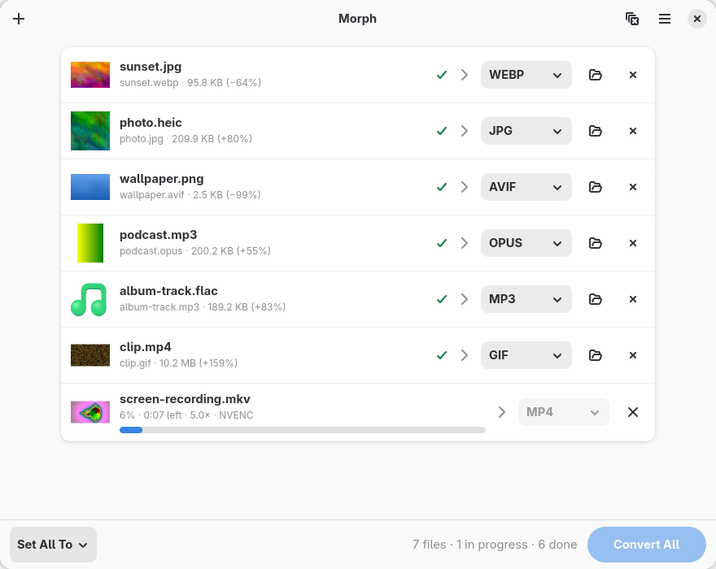

# Morph

A native file converter for GNOME. Drop files in, pick a format, convert — locally, nothing is uploaded.



- **Images** — PNG, JPEG, WebP, AVIF, HEIC, JPEG XL, GIF, TIFF, BMP (also reads SVG, PSD, RAW)
- **Audio** — MP3, FLAC, Ogg, Opus, WAV, M4A, AIFF, keeping tags and album art
- **Video** — MP4, MKV, WebM, MOV, AVI, GIF, or extract the soundtrack
- **GPU encoding** — NVIDIA NVENC or VAAPI (Intel, AMD), with automatic fallback to the CPU

## Install (Arch Linux)

Download `morph-converter-*.pkg.tar.zst` from [Releases](https://github.com/wioletowa/Morph/releases) and run:

```sh
sudo pacman -U morph-converter-*.pkg.tar.zst
```

Or build the package yourself:

```sh
git clone https://github.com/wioletowa/Morph.git
cd Morph
makepkg -si
```

## Build from source

Needs Rust, GTK ≥ 4.18, libadwaita ≥ 1.7, and at runtime `vips` and `ffmpeg`:

```sh
sudo pacman -S --needed rust gtk4 libadwaita libvips ffmpeg
cargo build --release
./target/release/morph
```

For GPU encoding install your GPU's driver: `nvidia-utils` (NVENC), `intel-media-driver` or `libva-mesa-driver` (VAAPI).

## Credits

Inspired by [VERT](https://vert.sh). Morph is an independent program: it contains no code or artwork from VERT
and is not affiliated with its authors. Conversions are done by [libvips](https://www.libvips.org) (LGPL-2.1+)
and [FFmpeg](https://ffmpeg.org) (LGPL/GPL), run as separate programs.

## License

[MIT](LICENSE)
